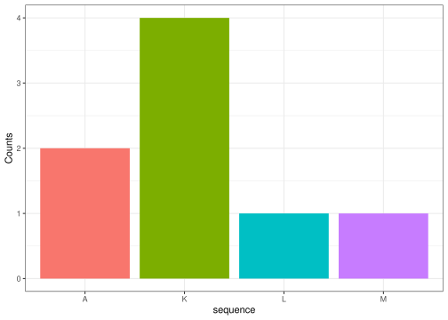
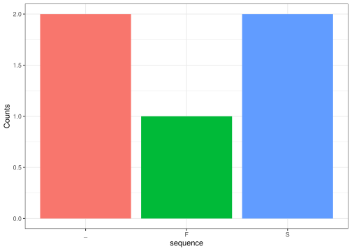

<!-- README.md is generated from README.Rmd. Please edit that file -->

# biodogma

#### A Guide to DNA and RNA Sequence Analysis

BioDogma is an R package designed to simplify basic DNA and RNA sequence
analysis. It provides a collection of functions that allow users to
generate random nucleotide sequences, transcribe DNA into RNA, divide
RNA sequences into codons, translate codons into amino acids, and
visualize amino acid frequencies.

The package combines these functions into a simple workflow, replicating
the central dogma of molecular biology. It allows users to explore the
relationship between nucleotide sequences and amino acid sequences
through practical examples in R.

``` r
library(biodogma)
```

## makeseq()

The “makeseq” function takes a positive integer number as its argument,
and creates a randomly generated sequence made of nucleotides.

You can use it as follows:

``` r
sequence_length <- 15
makeseq(sequence_length)
#> [1] "AATATACGATAACTT"
```

The output depends on both the size of the sequence to make and the
random sampling. Two sequences of the same length could be completely
different. Here’s an example:

``` r
sequence_1 <- makeseq(10) 
sequence_2 <- makeseq(10)  

#Outputs: 
print(sequence_1) 
#> [1] "TTTGTGTATG"
print(sequence_2)
#> [1] "ACTGTCTGCC"
```

## trans()

*`trans()`* substitutes the thymine base (T) of a DNA sequence with a
uracil base (U), creating an RNA sequence. It consists of one argument
`pattern` where the user inserts the DNA sequence.

``` r
trans(pattern = "TGCAGTT")
#> [1] "UGCAGUU"
```

## dividing_codons()

dividing_codons() function takes RNA sequence (string), counts where the
codon should start and divides the sequence into reading codes.

``` r
dividing_codons("AAUUGGCC")
#> [1] "AAU" "UGG"
#>[1] "AAU" "UGG"
```

The function identifies two complete codons, AAU and UGG. The remaining
two nucleotides, CC do not form a complete codon and are excluded.

## find_aa()

The `find_aa()` function translates an RNA codon into its corresponding
amino acid using the package’s codon_table lookup table. It accepts one
or more codons as input and returns the associated amino acid
abbreviations as a character string.

``` r
find_aa(codons = "UUU")
#> [1] "F"
```

The codon UUU encodes phenylalanine, represented by the one-letter
abbreviation F.

The function can also accept multiple codons:

``` r
find_aa(codons = c("UUU", "AUG", "GGU"))
#> [1] "FMG"
```

Here, UUU encodes phenylalanine (F), AUG encodes methionine (M), and GGU
encodes glycine (G). The function concatenates the results into a single
character string.

## count_plot()

The function takes in the sequence of amino acids as a parameter and
counts the appearance of each amino acid.

It is done by defining the unique amino acids from the sequence into a
new variable and then counting the number of times they appear in the
sequence. The data frame is created storing those counts.

The results are returned in a form of a barplot visualizing the amino
acids counts.

Example:

``` r
count_plot('AKLMAKKK')
```



## Example analysis with biodogma

``` r
# create a DNA sequence of 15 nucleotides
dna_seq <- makeseq(15)

# substitute the Ts of DNA with Us
rna_seq <- trans(dna_seq)

# devide the RNA sequence into codons
codon_seq <- dividing_codons(rna_seq)

# translate RNA codons into amino acids
amino_acid_seq <- find_aa(codon_seq)

# create a bar plot of the counts of each amino acid in the sequence
amino_acid_plot <- count_plot(amino_acid_seq)
amino_acid_plot
```



# Discussion

The ‘biodogma’ package can be useful for bioinformaticians working with
amino acids sequences. It provides functions for translations of the
codons’ sequence, its processing, and visualization of amino acids
count. It could be used for basic processing of the genetic information.
As future package additions the group considered a possibility of
multiple sequences comparison for example logo visualization.

The package holds only two dependencies that have been used for the
count_plot function. The amount of dependancies is preferably as small
as possible due to the maintance that comes with it. Although using
other packages ensures working functions, at the same time lowering the
possibility of potential bugs, they are independant and might change
over time meaning a need for changes in the created package itself.
Furthermore, installing additional packages takes space and power, so
controlling the amount of dependencies is crucial for a well working
package. They are added by running the usethis::usepackage() and are
then added to the description preferrably with specific functions needed
already defined. Nevertheless, the package::function() way of calling
out is still used to ensure no ambiguity.
